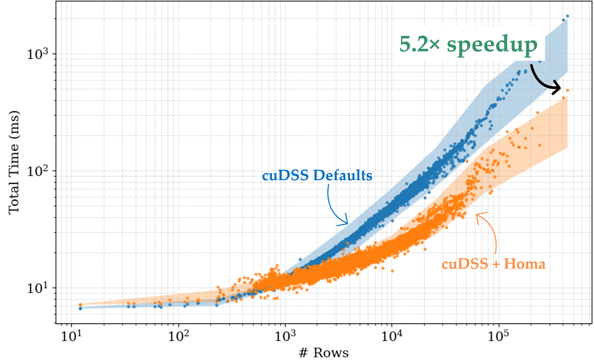
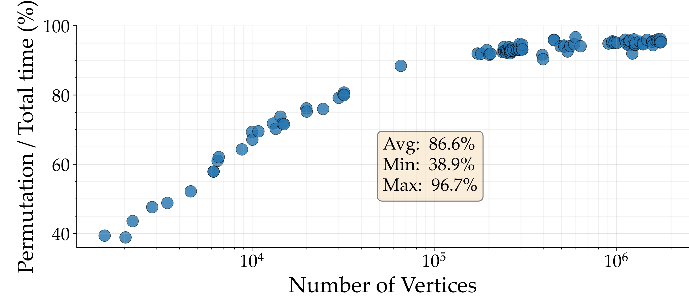

# Homa [](https://github.com/BehroozZare/fast-permute/actions/workflows/build.yml) [](https://pypi.org/project/homapy/)

Homa is a fast sparse matrix permutation library with Python and C++ APIs. It targets end-to-end acceleration of sparse Cholesky solvers by reducing the cost of computing fill-reducing permutations. Homa is particularly effective when matrix sparsity patterns change frequently and each factorization is used only a small number of times.

The benchmarks below compare cuDSS using its default ordering with cuDSS using Homa on Laplacian systems from the [Thingi10K](https://huggingface.co/datasets/Thingi10K/Thingi10K) dataset (left) and the [TetWild](https://huggingface.co/datasets/Thingi10K/Thingi10K) dataset (right).

<p align="left">
  
    
</p>

_Benchmark setup: Total time includes permutation, symbolic analysis, numerical factorization, and triangular solve. All experiments use floating-point arithmetic and were run on an NVIDIA RTX PRO 6000 GPU with an AMD EPYC 9555 64-core, 3.2 GHz CPU. **cuDSS Defaults** uses cuDSS's default METIS-based nested-dissection ordering, while **cuDSS + Homa** replaces only the permutation with Homa's ordering._

---

This repo has two complementary purposes:

1. **Fast Sparse Matrix Permutation:** Given the sparsity pattern of a sparse matrix, Homa computes a fill-reducing permutation and, when requested, an elimination tree. The result can be passed to any sparse Cholesky solver that accepts user orderings.

2. **Solvers front end:** Homa exposes one `ordering -> analyze -> factorize -> solve` workflow from Python and C++. The current supported backends are NVIDIA **cuDSS**, SuiteSparse **CHOLMOD**, and Intel MKL **PARDISO**.

The Python package is named `homapy`.

## Installation

For Python usage, install the Python bindings:

```bash
python -m pip install homapy
```

The GPU/cuDSS path requires a CUDA 12.x-compatible NVIDIA driver and CUDA 12.x runtime libraries. For Python examples, install `scipy` for CPU sparse matrices and a CUDA-12-compatible CuPy build for GPU-resident matrices:

```bash
python -m pip install scipy
# Install the CuPy package that matches your CUDA 12.x environment.
```

<details>

<summary> For C++ usage, using Homa in your CMake project (FetchContent):</summary>


When using Homa from another CMake project, call `homa_configure_runtime()` for targets that link Homa so enabled solver runtimes are configured correctly.

```cmake
include(FetchContent)
FetchContent_Declare(homa
    GIT_REPOSITORY https://github.com/BehroozZare/fast-permute.git
    GIT_TAG        v0.1.0
)
FetchContent_MakeAvailable(homa)

target_link_libraries(my_target PRIVATE Homa::homa)
homa_configure_runtime(my_target)
```
</details>

## Quick Start

### Python

For cuDSS on the GPU, use `cupyx.scipy.sparse` CSR matrix to keep the matrix on the GPU. Homa passes the CSR device pointers to cuDSS, so repeated solves and refactorizations do not lead to host-device memcpy.

```python
import cupy as cp
import cupyx.scipy.sparse as csp
import numpy as np
import scipy.sparse as sp
import homapy

n = 10
A_cpu = sp.diags(
    [-np.ones(n - 1), 4.0 * np.ones(n), -np.ones(n - 1)],
    [-1, 0, 1],
    format="csr",
)
b_cpu = np.ones(n)

A_gpu = csp.csr_matrix(A_cpu)
b_gpu = cp.asarray(b_cpu)

solver = homapy.Solver(backend="cudss", dtype="float64")
solver.set_matrix(A_gpu)
solver.ordering(patch_size=512, local_method="amd", patch_method="greedy")
solver.analyze_pattern()
solver.factorize()
x_gpu = solver.solve(b_gpu)
```

Mutate the values and refactorize without repeating ordering or analysis:

```python
A_gpu.setdiag(A_gpu.diagonal() + 0.5)
solver.refactorize(A_gpu)
x2_gpu = solver.solve(A_gpu @ cp.ones(n))
```

CHOLMOD and MKL/PARDISO on the CPU use the same Python front-end on host CSR matrices:

```python
x_mkl = homapy.spsolve(A_cpu, b_cpu, backend="mkl", dtype="float64")
x_cholmod = homapy.spsolve(A_cpu, b_cpu, backend="cholmod", dtype="float64")
```

You can also use Homa only for ordering:

```python
perm, etree = homapy.compute_ordering(
    A_cpu,
    patch_size=512,
    local_method="amd",
    patch_method="greedy",
    compute_etree=True,
)
```


### C++

The standalone ordering API takes the sparsity pattern of a square symmetric matrix:

```cpp
#include "homa/homa.h"

homa::Options opts;
opts.patch_size = 512;
opts.compute_etree = true; 

homa::OrderingResult ord = homa::compute_ordering(A, opts);
// ord.perm  is a permutation of [0, n)
// ord.etree is filled when compute_etree is true
```

For cuDSS, Homa can consume device CSR pointers through `SparseMatrixView`:

```cpp
#include "homa/solvers/LinSysSolver.h"

std::unique_ptr<homa::LinSysSolverD> solver(
    homa::LinSysSolverD::create(homa::LinSysSolverType::GPU_CUDSS));

homa::SparseMatrixView<double> Adev{
    n,
    n,
    nnz,
    d_rowptr,
    d_colind,
    d_values,
    homa::SparseFormat::CSR,
    homa::MemoryLocation::Device,
};

solver->setMatrix(Adev);
solver->ordering(opts);
solver->analyze_pattern();
solver->factorize();
solver->solve(rhs, result);
```

The same solver interface also supports CPU backends:

```cpp
auto backend = homa::LinSysSolverType::CPU_CHOLMOD;
         // or homa::LinSysSolverType::CPU_MKL
std::unique_ptr<homa::LinSysSolverD> cpu_solver(homa::LinSysSolverD::create(backend));
```

MKL/PARDISO expects lower-triangular storage:

```cpp
Eigen::SparseMatrix<double> A_lower = A.triangularView<Eigen::Lower>();
A_lower.makeCompressed();
cpu_solver->setMatrix(A_lower);
```


## When to use Homa

Computing a fill-reducing permutation can account for a substantial portion of the end-to-end runtime of a sparse direct solve. For the large Laplacian systems from Thingi10K (below), permutation takes up to **96% of the end-to-end solve time**.


<p align="left">
  
</p>

Homa is most effective when the matrix sparsity pattern changes frequently, requiring a new permutation and symbolic analysis, and each resulting factorization is used to solve only one or a few right-hand sides. In this setting, reducing permutation time can substantially reduce the end-to-end runtime.

This reduction in ordering time comes with a tradeoff. Homa may produce more fill than slower ordering methods, e.g., METIS. This can increase numerical factorization time, triangular-solve time, and memory consumption. If the same sparsity pattern is refactorized many times, the cost of a slower but higher-quality ordering can be amortized and may provide better overall performance.

## Development

For local Python builds and wheel development, see [python/README.md](./python/README.md). For C++ examples and benchmark drivers, see [examples/README.md](./examples/README.md).

## Citation

If you use Homa's ordering in academic work, please cite:

```bibtex
@inproceedings{Zarebavani:2026:FSM,
  title     = {Fast Sparse Matrix Permutation for Mesh-Based Direct Solvers},
  author    = {Zarebavani, Behrooz and Mahmoud, Ahmed H. and Dodik, Ana and Yuan, Changcheng and Porumbescu, Serban D. and Owens, John D. and Mehri Dehnavi, Maryam and Solomon, Justin},
  year      = {2026},
  isbn      = {9798400725548},
  publisher = {Association for Computing Machinery},
  address   = {New York, NY, USA},  
  month     = jul,
  series    = {SIGGRAPH Conference Papers '26},
  booktitle = {Proceedings of the Special Interest Group on Computer Graphics and Interactive Techniques Conference Conference Papers},
  articleno = {136},
  numpages = {11},
  doi       = {10.1145/3799902.3811189}
}
```